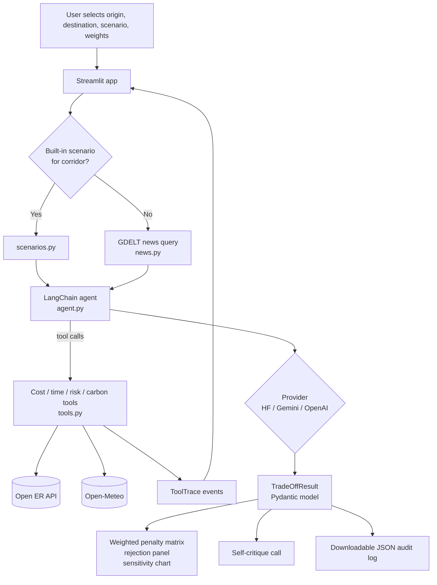

<div align="center">

<h1>AeroTrade XAI</h1>

<p><strong>An autonomous supply-chain agent that evaluates alternative freight routes during disruption scenarios and explains every recommendation through a transparent, weight-driven dashboard.</strong></p>

[](LICENSE)
[](CONTRIBUTING.md)
[](https://www.python.org/)
[](https://streamlit.io/)
[](https://www.langchain.com/)
[](https://docs.pydantic.dev/)
[](#status-and-scope)

</div>

## Overview

Global supply chains are fragile. A port strike, canal blockage, border closure, or severe weather event can invalidate a logistics plan overnight. Planners must compare cost, transit time, risk, and carbon emissions under time pressure, and they need to understand *why* an automated system prefers one route over another before acting on it.

AeroTrade XAI is a research and demonstration application for that workflow. It combines a LangChain tool-calling agent with deterministic route-scoring tools, a Streamlit interface, and Pydantic-validated output. The goal is not to replace a transportation management system, but to make the agent's reasoning inspectable: every tool call is visible, every rejected route receives a written justification, and the ranking can be re-computed from explicit user weights using a documented formula.

## Key features

- **Scenario-driven evaluation.** Fifteen built-in disruption scenarios cover port strikes, canal blockages, typhoons, border closures, piracy, customs outages, and other events. Each scenario supplies a set of candidate routes.
- **Autonomous tool use.** The agent calls cost, time, risk, and carbon tools for every candidate route before producing a final decision. Tool calls are streamed into the UI as they happen.
- **Structured decisions.** The final recommendation is validated against a `TradeOffResult` Pydantic model containing the chosen route, per-route scores, and rejection reasons for all alternatives.
- **Transparent trade-offs.** Four sidebar sliders set the relative importance of cost, speed, reliability, and sustainability. The dashboard recalculates a normalized weighted penalty score in Python, independent of the LLM.
- **Explainability panels.** The interface shows an execution log, an executive summary, a rejection analysis, a sensitivity breakdown, and an audit log that can be downloaded as JSON.
- **Self-critique.** A second LLM call asks for one weakness in the chosen route's justification, surfacing a counterargument next to the recommendation.
- **Route visualization.** Selected routes are rendered with PyDeck; seaborne legs use `searoute` for path geometry when available.
- **Live context hooks.** For corridors without a built-in scenario, the app queries GDELT for recent disruption news and builds a baseline scenario from the result. Cost and risk tools also attempt live FX and weather lookups.

## Status and scope

This repository is a prototype. The route metrics are heuristic baselines, not commercial freight quotes or audited emissions data. The agent demonstrates orchestration, structured output, and explainability; it does not execute bookings or write to an ERP/TMS.

| Capability | Status |
|---|---|
| Disruption scenarios and candidate routes | Implemented (hard-coded data) |
| LLM tool-calling loop over four metric tools | Implemented |
| Pydantic-validated structured decision | Implemented, with retry and JSON fallback |
| Weighted trade-off matrix and sensitivity chart | Implemented |
| Rejected-alternative explanations and self-critique | Implemented |
| GDELT news lookup for unlisted corridors | Implemented, best effort |
| Live FX / weather adjustments | Implemented as small heuristic adjustments |
| Carrier quotes | **Simulated** in `ui_components.py`; not real quotes |
| "Book now", ERP/TMS integration, authentication, persistence | Not implemented |
| Follow-up Q&A | `answer_followup` exists in `agent.py` but is not exposed in the UI |

## Architecture



### Agent lifecycle

1. `app.py` filters the scenario catalogue by the selected origin and destination. If no scenario matches, `news.py` queries GDELT; if that returns nothing, a "business as usual" baseline is generated.
2. `agent.run_agent` binds four LangChain tools and sends the scenario plus candidate routes to the selected provider.
3. The agent loops: the model requests tools, the app executes them, records a `ToolTrace`, and appends the result as a `ToolMessage`. The loop ends when the model stops requesting tools.
4. A final instruction asks for a `TradeOffResult`. If the provider supports structured output, LangChain parses it directly; otherwise the app falls back to `JsonOutputParser`-style extraction with up to three attempts.
5. `run_self_critique` performs one additional LLM call, and the Streamlit UI renders the decision, matrix, rejection reasons, map, and audit log.

### Explainability model

The displayed **Penalty Score** is computed locally, not by the LLM. For each route and each metric, the app normalizes the value against the maximum observed value in the current comparison set, then applies the normalized user weight:

```text
penalty(route) = Σ [ (weight_i / Σ weights) × (metric_i / max(metric_i)) ]
                for i in {cost, time, risk, carbon}
```

Lower is better. A total weight of zero is guarded against by substituting `1.0`. The matrix can therefore re-rank routes instantly when sliders move, while the agent's original recommendation remains visible for comparison. This separation between LLM judgment and deterministic scoring is the core transparency mechanism.

## Tech stack

| Layer | Technology | Role |
|---|---|---|
| UI | Streamlit | Interactive dashboard, sidebar controls, state management |
| Agent | LangChain | Tool binding, message loop, structured output |
| Validation | Pydantic | `RouteOption`, `ToolTrace`, `TradeOffResult` schemas |
| LLM providers | Hugging Face, Google Gemini, OpenAI | Reasoning and tool selection |
| Data | pandas | Trade-off matrix and chart data |
| Mapping | PyDeck, searoute | Route arcs and sea-path geometry |
| HTTP | requests | GDELT, Open ER API, Open-Meteo |
| Runtime | Python 3.11+ | Application runtime |

## Project structure

```text
AeroTrade-XAI/
├── app.py               # Streamlit entry point, layout, session state
├── agent.py             # Provider selection, tool loop, structured output
├── tools.py             # Cost, time, risk, carbon tools (heuristic)
├── models.py            # Pydantic schemas
├── scenarios.py         # 15 hard-coded disruption scenarios and routes
├── news.py              # GDELT disruption-news lookup
├── ui_components.py     # Matrix, map, rejection, quote, sensitivity rendering
├── requirements.txt     # Python dependencies
├── Dockerfile           # Container image for the Streamlit app
└── .gitignore
```

## Prerequisites

- Python 3.11 or newer
- An API key for at least one supported LLM provider
- Docker (optional, for containerized use)
- Network access for GDELT, Open ER API, and Open-Meteo lookups (the app degrades gracefully when they are unavailable)

## Setup

```bash
git clone https://github.com/ishanvaidya01/AeroTrade-XAI.git
cd AeroTrade-XAI

python -m venv venv
# Windows PowerShell
venv\Scripts\Activate.ps1
# macOS / Linux
source venv/bin/activate

pip install -r requirements.txt
```

Create a `.env` file in the repository root. The application loads it with `python-dotenv`. Provide **one** provider key; the first configured provider in the priority order below is used.

```dotenv
# Google Gemini (used if HUGGINGFACEHUB_API_TOKEN is not set)
GEMINI_API_KEY=your_gemini_key_here

# Optional alternatives
# HUGGINGFACEHUB_API_TOKEN=your_hugging_face_token_here
# OPENAI_API_KEY=your_openai_key_here
```

If no key is present, the app stops with an error instead of starting in a partially configured state.

### Environment variables

| Variable | Required | Used when | Effect |
|---|---|---|---|
| `HUGGINGFACEHUB_API_TOKEN` | One of three | Highest priority | Uses `Qwen/Qwen2.5-72B-Instruct` through `HuggingFaceEndpoint` and `ChatHuggingFace` |
| `GEMINI_API_KEY` | One of three | When no Hugging Face token is set | Uses `ChatGoogleGenerativeAI` with `gemini-flash-latest` at temperature 0 |
| `OPENAI_API_KEY` | One of three | Fallback when neither above is set | Uses `ChatOpenAI` with `gpt-4o` at temperature 0 |

There are no other application environment variables. Do not commit your `.env` file.

## Run

```bash
streamlit run app.py
```

Open the URL printed by Streamlit, normally <http://localhost:8501>.

### Docker

```bash
docker build -t aerotrade-xai .
docker run --rm -p 8501:8501 --env-file .env aerotrade-xai
```

The image exposes port `8501`, runs as the default container user, and includes a health check against Streamlit's `/_stcore/health` endpoint. The Dockerfile installs `build-essential`, `curl`, and `git` because some Python dependencies may need to build native extensions.

## Usage

1. Choose an origin and destination in the sidebar. The available scenario list is filtered to that corridor.
2. Select one of the built-in disruption scenarios, a live-news scenario, or the business-as-usual baseline.
3. Adjust the cost, speed, reliability, and sustainability weights.
4. Select **Run Agent**. The left column streams tool calls; the right column populates when a validated decision is available.
5. Review the recommendation, self-critique, trade-off matrix, rejected alternatives, route map, and sensitivity chart.
6. Optionally download the full audit log as JSON.

The audit log contains the structured decision and the complete tool trace, which makes a run reproducible for review even though the underlying metrics are heuristic.

## External integrations

This project exposes no HTTP API of its own; it is a Streamlit application. It calls the following external services at runtime:

| Service | Endpoint | Used for |
|---|---|---|
| GDELT DOC 2.0 | `https://api.gdeltproject.org/api/v2/doc/doc` | Recent disruption news for corridors without a built-in scenario |
| Open ER API | `https://open.er-api.com/v6/latest/EUR` | USD conversion factor applied to the synthetic cost baseline |
| Open-Meteo | `https://api.open-meteo.com/v1/forecast` | Wind-speed adjustment to the risk score (fixed Berlin coordinates) |
| `searoute` package | Local computation | Sea-route geometry for the map, with direct-arc fallback |

All four calls are wrapped in broad exception handling. A failed lookup should not prevent a decision, but it can change the metric values slightly.

## Testing

No automated test suite is included. The repository also has no linter or CI configuration. A minimal smoke check is:

```bash
python -m compileall .
streamlit run app.py
```

Then run at least one scenario and confirm that tool traces appear, a recommendation is rendered, and the audit-log download succeeds. When changing the agent loop or schemas, test with each provider you intend to support because structured-output behavior differs between LangChain integrations.

## Limitations

- **Synthetic economics.** Cost, time, risk, and carbon values come from mode-based baselines plus deterministic route-ID seeds. They are suitable for demonstrating trade-offs, not for procurement.
- **Simulated quotes.** The "Live Carrier Quotes" table is generated with a seeded random function; carrier names are illustrative and no carrier API is contacted.
- **Weather adjustment is not route-specific.** Open-Meteo is queried at fixed coordinates, so wind affects all routes through the same adjustment.
- **No guardrail on agent iterations.** The tool loop has no explicit maximum step count; an uncooperative model can keep calling tools.
- **LLM output can still fail.** The JSON fallback can return a placeholder result if parsing fails three times. Treat such a result as an error, not a recommendation.
- **No persistence or access control.** Runs exist in Streamlit session state only; there is no database, login, or multi-user isolation.
- **Unpinned dependencies.** `requirements.txt` has no version constraints and the repository has no lockfile, so builds can drift over time.

## Roadmap

The following items were proposed in the original project brief and are **not implemented**:

- Replace heuristic tools with live logistics provider APIs for quotes and transit times.
- Add multi-agent negotiation between cost- and speed-focused agents.
- Add a booking hand-off to a TMS/ERP after human approval.
- Add automated tests and a pinned dependency lockfile.

## Contributing

Contributions are welcome. Please read [CONTRIBUTING.md](CONTRIBUTING.md) for the development setup, branch naming, commit conventions, and pull-request checklist. By participating, you agree to follow [CODE_OF_CONDUCT.md](CODE_OF_CONDUCT.md).

For security issues, follow [SECURITY.md](SECURITY.md) instead of opening a public issue.

## License

Released under the MIT License. See [LICENSE](LICENSE) for the full text.

## Contact

Maintainer: **Ishan Vaidya** — [ishan.vaidya01@gmail.com](mailto:ishan.vaidya01@gmail.com)

Original project collaborators: Ishan Vaidya and Rishav Ghosh.

## Acknowledgements

- [LangChain](https://www.langchain.com/) for agent orchestration and provider integrations
- [Streamlit](https://streamlit.io/) for the application framework
- [GDELT Project](https://www.gdeltproject.org/) for the news API
- [Open-Meteo](https://open-meteo.com/) and [Open ER API](https://www.exchangerate-api.com/) for open data endpoints
- [searoute](https://github.com/eurostat/searoute) for sea-route geometry
- The open-source Python, Pydantic, pandas, and PyDeck communities
